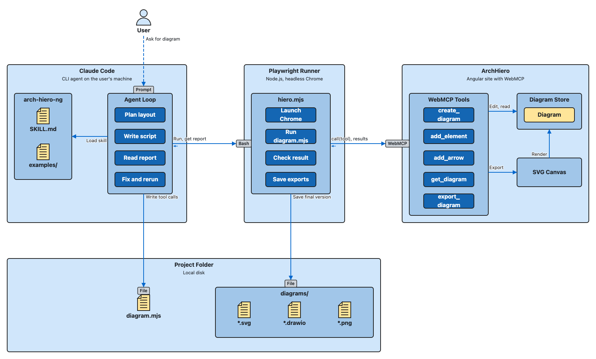

# arch-hiero-ng

An agent skill that builds architecture diagrams in [ArchHiero](https://arch-hiero.vercel.app/) and exports them as SVG, draw.io, and PNG files.

ArchHiero is a browser app that draws architecture diagrams. It offers its editing tools to AI agents through [WebMCP](https://github.com/webmachinelearning/webmcp). With this skill, an agent such as Claude Code turns a plain-language description into a laid-out diagram. The agent plans the layout, calls ArchHiero's tools, checks the result, fixes it, and saves the files.



## Diagram types

| Type | Shows | Arrows |
| --- | --- | --- |
| `conceptual` | Actors, applications, the components, processes, and data in them, and jobs | Labelled, with a connector (interface), manual or automated, one- or two-way |
| `physical` | Users, servers, databases, load balancers, firewalls, gateways, and storage in zones and networks | Protocol and port |
| `deployed-component` | Components in layers, such as network zones, with protocols and tech stacks | None |

## How it works

1. **Load the skill.** The agent reads [`SKILL.md`](.agents/skills/arch-hiero-ng/SKILL.md). It covers how arrows attach, how to plan a layout, and the conventions for each diagram type.
2. **Write a script.** The agent writes a `diagram.mjs` file of tool calls (`create_diagram`, `add_element`, `add_arrow`, `resize_element`, and so on). It starts from the closest example in [`examples/`](.agents/skills/arch-hiero-ng/examples).
3. **Run it.** [`scripts/hiero.mjs`](.agents/skills/arch-hiero-ng/scripts/hiero.mjs) opens ArchHiero in headless Chrome with Playwright, runs the script against the app's WebMCP tools, and saves the diagram.
4. **Fix and rerun.** The runner reports any arrow that isn't straight and any text that's cut off. The agent also looks at the PNG. It then fixes the script and runs it again until the diagram is clean.

If the agent has Playwright MCP tools named `webmcp_*`, it can call ArchHiero's tools directly instead of writing a script.

## Setup

You need Node.js and Google Chrome. Without Chrome, Playwright downloads its own Chromium.

```bash
npm install --prefix .agents/skills/arch-hiero-ng/scripts
# Only if Google Chrome isn't installed:
npx --prefix .agents/skills/arch-hiero-ng/scripts playwright install chromium
```

The skill is stored in `.agents/skills/`. `.claude/skills` is a symlink to it, so Claude Code finds it too.

## Usage

Ask your agent for a diagram, or invoke the skill by name:

```text
/arch-hiero-ng Create a conceptual diagram of an HR employee adding a user into Workday.
After the user is entered, Workday sends it upstream to Active Directory. Workday is a
cloud solution.
```

You can also run a diagram script yourself:

```bash
node .agents/skills/arch-hiero-ng/scripts/hiero.mjs my-diagram.mjs --out diagrams
```

| Option | Default | Purpose |
| --- | --- | --- |
| `--out <folder>` | `diagrams` | Where to save the SVG, draw.io, and PNG files |
| `--url <url>` | `https://arch-hiero.vercel.app/` | Use another copy of ArchHiero, such as `http://localhost:4200/` |
| `--scale <n>` | `1` | PNG scale |
| `--headed` | off | Show the browser while it runs |

A diagram script default-exports an async function. It's given `call(tool, input)`, which runs a tool and returns its result, and `save(diagramId, name)`, which writes `<name>.svg`, `.drawio`, and `.png`:

```js
export default async ({ call, save }) => {
  const { id: diagramId } = await call('create_diagram', { type: 'conceptual', name: 'Order Entry' });
  const app = await call('add_element', { diagramId, kind: 'application', label: 'Order Entry', x: 40, y: 200 });
  const user = await call('add_element', { diagramId, kind: 'actor', label: 'User', x: 40, y: 40 });
  await call('add_arrow', { diagramId, sourceId: user.id, targetId: app.id, label: 'Place order', connector: 'Web' });
  await save(diagramId, 'conceptual-order-entry');
};
```

Each run starts in a fresh browser profile with no diagrams, so a script builds its whole diagram from scratch.

## Examples

The skill's own starting points are in [`examples/`](.agents/skills/arch-hiero-ng/examples): a conceptual order entry diagram, a physical 3-tier web app, and a deployed component web app.

## Project layout

```text
.agents/skills/
  arch-hiero-ng/
    SKILL.md            Instructions the agent follows
    examples/           Example diagram scripts, one per diagram type
    scripts/hiero.mjs   Playwright runner that drives ArchHiero and saves exports
  commit/               A helper skill for Conventional Commits messages
.claude/skills          Symlink to .agents/skills
images/                 Images used in this README
```

## License

[MIT](LICENSE)
